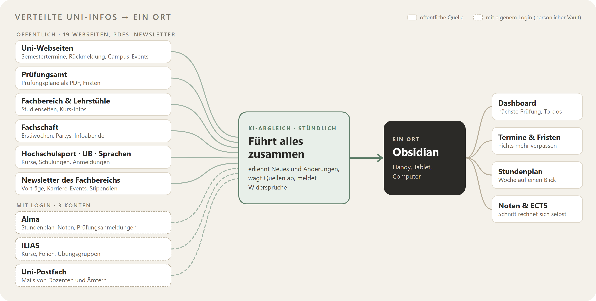

### Hallo, ich bin Philip 👋

EBA-Student (B.Sc.) an der Uni Tübingen. Ich baue Werkzeuge, die **verstreute Informationen mit KI zusammenführen** und
**übersichtlich darstellen**.

#### 🚀 [Studium Autopilot](https://github.com/studium-autopilot/ecoba)

Uni-Infos stecken in vielen Quellen. Studium Autopilot führt sie stündlich per KI zusammen und zeigt sie an einem Ort.

Kostenlos · ohne Konto · ohne Tracking · [Vorlage](https://github.com/studium-autopilot/ecoba) · [geprüfte Daten](https://github.com/studium-autopilot/ecoba-daten)

🛠️ Python · JavaScript · LLMs · Obsidian-Plugins · GitHub Actions · Linux-Server

🇬🇧 Economics & Business student in Tübingen. Studium Autopilot uses AI to merge scattered university sources into one clear Obsidian workspace.
